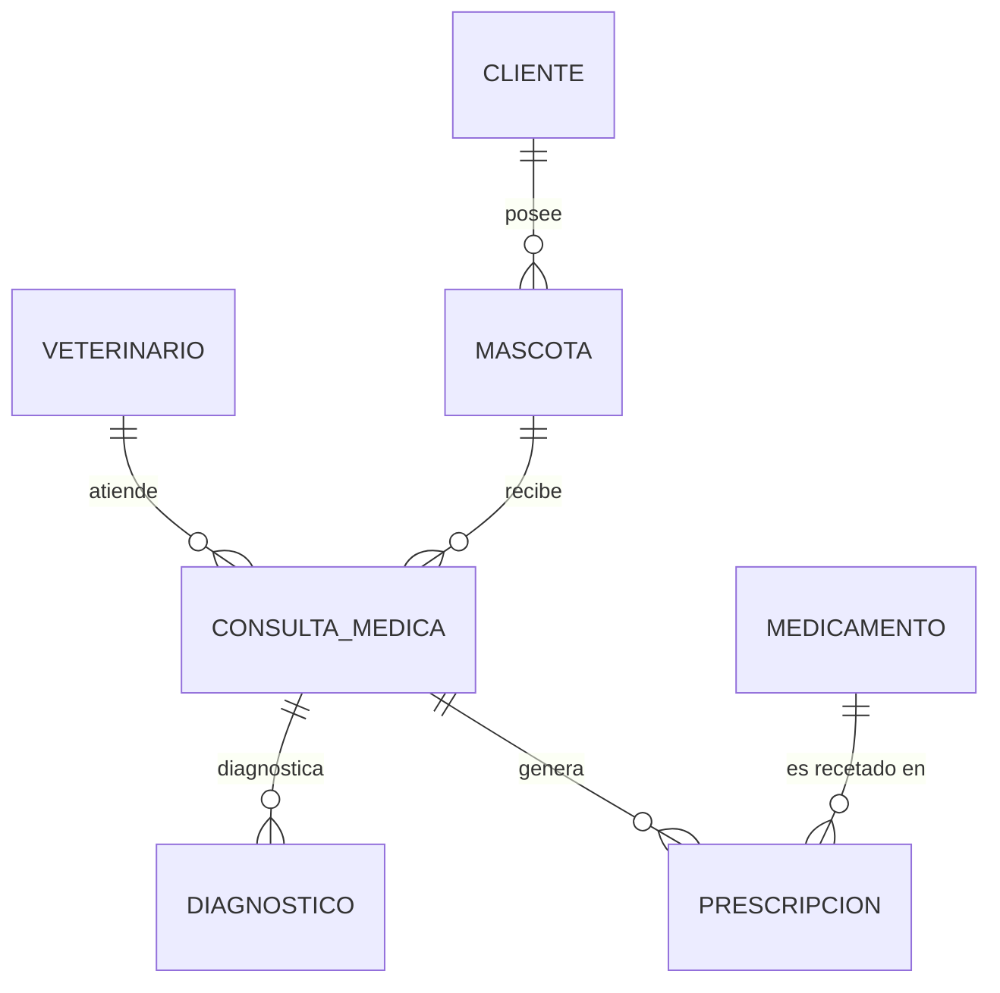

# ProtoZOO · Sistema de gestión veterinaria

ProtoZOO es un sistema web para una clínica veterinaria con farmacia. Lleva el registro de los clientes y sus mascotas, el personal médico, el inventario de medicamentos y la historia clínica de cada mascota: consultas con signos vitales, diagnósticos y recetas. Al emitir una receta el sistema descuenta el stock del medicamento, y al cancelarla lo devuelve. El acceso se controla con JWT y tres roles (administrador, veterinario y recepcionista). Está formado por una API REST en Spring Boot y una aplicación de una sola página en Angular, y se construyó como proyecto del curso de Plataformas de la UPB.

## Integrantes

- Juan Esteban Correa Castro
- Juan Pablo González Zabala

## Tecnologías

| Componente | Tecnología | Versión |
|---|---|---|
| Backend | Java (JDK) | 25 |
| | Spring Boot (Web MVC, Data JPA, Security) | 4.1.0 |
| | JJWT (tokens JWT) | 0.12.6 |
| | springdoc-openapi (especificación y Swagger UI) | 3.2.0 |
| | Maven (incluido como wrapper `mvnw`) | 3.9.16 |
| Base de datos | PostgreSQL | 18 |
| Frontend | Angular (componentes standalone) | 22.2 |
| | TypeScript | 6.0 |
| Pruebas | JUnit 5 + Mockito, H2 en memoria (solo pruebas), JaCoCo | 0.8.13 (JaCoCo) |
| | Vitest + jsdom | 4.1 / 30.1 |

## Requisitos previos

| Herramienta | Versión |
|---|---|
| JDK | 25 |
| Node.js | 24.15 o superior (también 22.22.3+ o 26+) |
| npm | 11 (viene con Node.js) |
| PostgreSQL | 18 (probado; sirve 15 o superior) |

Maven no hace falta instalarlo: el repositorio trae el wrapper (`mvnw` / `mvnw.cmd`).

## 1. Preparar la base de datos

Crear una base de datos vacía llamada `VeterinariaS`, desde pgAdmin o con `psql`:

```sql
CREATE DATABASE "VeterinariaS";
```

Las tablas no se crean a mano: Hibernate las genera al primer arranque (`ddl-auto: update`).

## 2. Variables de entorno

Las credenciales de la base de datos no están en el repositorio: el backend las lee de variables de entorno.

| Variable | Valor por defecto | Descripción |
|---|---|---|
| `DB_USERNAME` | _(ninguno, obligatoria)_ | Usuario de PostgreSQL, por ejemplo `postgres` |
| `DB_PASSWORD` | _(ninguno, obligatoria)_ | Contraseña de ese usuario |
| `DB_URL` | `jdbc:postgresql://localhost:5432/VeterinariaS` | URL JDBC de la base |
| `JWT_SECRET` | clave de desarrollo incluida en `application.yaml` | Clave para firmar los tokens; en un despliegue real se define una propia |

Se definen en la misma terminal desde la que se levanta el backend:

```powershell
# PowerShell
$env:DB_USERNAME = "postgres"
$env:DB_PASSWORD = "<tu-contraseña>"
```

```cmd
:: cmd
set DB_USERNAME=postgres
set DB_PASSWORD=<tu-contraseña>
```

```bash
# bash / macOS / Linux
export DB_USERNAME=postgres
export DB_PASSWORD='<tu-contraseña>'
```

## 3. Levantar el backend

Desde la raíz del repositorio, en la terminal donde se definieron las variables:

```bash
./mvnw spring-boot:run
```

En Windows (cmd o PowerShell):

```cmd
.\mvnw.cmd spring-boot:run
```

La API queda en **http://localhost:8080** (por ejemplo, `POST http://localhost:8080/api/auth/login`).

## 4. Levantar el frontend

En otra terminal, desde la carpeta `frontend/`:

```bash
cd frontend
npm install
npm start
```

El frontend queda en **http://localhost:4200**.

El navegador llama a la API en `http://localhost:4200/api/...`, y el servidor de desarrollo de Angular reenvía esas peticiones a `http://localhost:8080` según [`frontend/proxy.conf.json`](frontend/proxy.conf.json). Como el navegador solo habla con un origen, no hace falta CORS.

## URL y puertos

| Componente | URL |
|---|---|
| Frontend (SPA) | http://localhost:4200 |
| API REST | http://localhost:8080/api |
| Swagger UI | http://localhost:8080/swagger-ui.html |
| Especificación en vivo | http://localhost:8080/v3/api-docs |
| PostgreSQL | localhost:5432, base `VeterinariaS` |

## Usuarios de prueba

Se crean solos al arrancar el backend por primera vez:

| Rol | Usuario | Contraseña | Acceso |
|---|---|---|---|
| ADMIN | `admin` | `admin123` | Todo, incluido usuarios, veterinarios y eliminar registros |
| VETERINARIO | `veterinario` | `vet123` | Área clínica: consultas, diagnósticos y recetas; farmacia |
| RECEPCIONISTA | `recepcion` | `recep123` | Clientes y mascotas; consulta de veterinarios y farmacia |

## Datos de prueba

Al primer arranque, con la base vacía, el backend también crea:

| Entidad | Datos |
|---|---|
| Clientes | Camila Restrepo, Juan Pablo Gomez |
| Mascotas | Firulais (perro) y Michi (gato) de Camila; Rocky (perro) de Juan Pablo |
| Veterinarios | Dr. Carlos Gomez (TP-88492), Dra. Maria Fernandez (TP-99214) |
| Medicamentos | Amoxicilina 500mg (stock 45), Meloxicam 1mg (stock 8, por debajo del mínimo), Antiparasitario Canino (stock 20) |
| Consulta | Firulais atendido por el Dr. Carlos Gomez, con el diagnóstico "Traqueobronquitis infecciosa" |

Con estos datos se recorren los flujos principales sin crear nada antes:

1. **Sesión:** entrar con `admin` / `admin123`; con una contraseña errónea la API responde 401 y la aplicación lo informa.
2. **CRUD de clientes:** crear, listar, editar y eliminar un cliente desde la pantalla de Clientes.
3. **Receta con descuento de inventario:** abrir la consulta de Firulais y emitir una receta de Amoxicilina por 14 unidades (lo puede hacer `veterinario` o `admin`). El stock baja de 45 a 31. Como `admin`, eliminar esa receta devuelve el stock a 45.
4. **Permisos por rol:** como `recepcion`, el área clínica no aparece y la API responde 403 si se intenta por fuera de la interfaz.

## Pruebas

**Backend** (desde la raíz; usa H2 en memoria, no necesita PostgreSQL ni las variables de entorno):

```bash
./mvnw verify
```

Corre las pruebas unitarias y de integración, y JaCoCo hace fallar el comando si la cobertura de líneas de la capa de servicios (`co.edu.upb.veterinaria.service`) queda por debajo del 80 %. El reporte queda en `target/site/jacoco/index.html`.

**Frontend** (desde `frontend/`; corre con Vitest sobre jsdom, sin navegador y sin modo watch):

```bash
cd frontend
npm test
```

Cubre el servicio de autenticación, el interceptor que adjunta el token, el interceptor de errores y el servicio de clientes del CRUD.

## Documentación de la API (OpenAPI)

La especificación está en [`openapi.yaml`](openapi.yaml), en la raíz del repositorio (OpenAPI 3.1.0). Documenta los 44 endpoints con sus parámetros, cuerpos, códigos de respuesta (incluidos 400, 401, 403, 404 y 409) y el esquema de autenticación Bearer JWT.

El archivo se genera a partir de la API real. Para regenerarlo después de cambiar un controlador:

```bash
./mvnw test -Dtest=ExportarOpenApiTest -Dopenapi.exportar=true -Djacoco.skip=true
```

## Arquitectura

```
Navegador ──HTTP──▶ Angular (dev server :4200) ──proxy /api──▶ Spring Boot (:8080) ──JDBC──▶ PostgreSQL (:5432)
```

Dentro del backend cada petición recorre `JwtAuthenticationFilter → Controller → Service → Repository → PostgreSQL`:

| Capa | Paquete | Responsabilidad |
|---|---|---|
| Seguridad | `security` | `JwtService` emite y valida los tokens; `JwtAuthenticationFilter` los lee de cada petición; `SecurityConfig` define qué rol entra a qué ruta |
| Controladores | `controller` | Endpoints REST y traducción de errores a códigos HTTP (`ManejadorGlobalDeErrores`) |
| Servicios | `service` | Reglas de negocio: validaciones, control de stock al recetar |
| Repositorios | `repository` | Acceso a datos con Spring Data JPA |
| Modelo | `model` | Entidades JPA |

En el frontend, `AuthService` guarda la sesión en `localStorage` (sobrevive a recargar la página), `authInterceptor` agrega `Authorization: Bearer <token>` a cada petición y `errorInterceptor` avisa al usuario y cierra la sesión cuando la API responde 401. Ver [`frontend/README.md`](frontend/README.md).

### Modelo de datos



`USUARIO` (username, contraseña cifrada con BCrypt y rol) es independiente y solo se usa para iniciar sesión.

### Permisos por rol

| Ruta | ADMIN | VETERINARIO | RECEPCIONISTA |
|---|---|---|---|
| `/api/usuarios/**` | Sí | No | No |
| `DELETE` en cualquier ruta | Sí | No | No |
| `GET /api/veterinarios/**` | Sí | Sí | Sí |
| Crear o editar veterinarios | Sí | No | No |
| `/api/consultas/**`, `/api/diagnosticos/**`, `/api/prescripciones/**` | Sí | Sí | No |
| `GET /api/medicamentos/**` | Sí | Sí | Sí |
| Crear o editar medicamentos | Sí | Sí | No |
| `/api/clientes/**`, `/api/mascotas/**` (sin eliminar) | Sí | Sí | Sí |

| Situación | Código |
|---|---|
| Sin token, o token inválido o expirado | `401 Unauthorized` |
| Usuario o contraseña incorrectos en el login | `401 Unauthorized` |
| Token válido pero el rol no tiene permiso | `403 Forbidden` |

### Probar la API desde la terminal

```bash
curl -X POST http://localhost:8080/api/auth/login -H "Content-Type: application/json" -d "{\"username\":\"admin\",\"password\":\"admin123\"}"
```

La respuesta trae un `token`, que se envía en las demás peticiones:

```bash
curl http://localhost:8080/api/clientes -H "Authorization: Bearer <token>"
```
